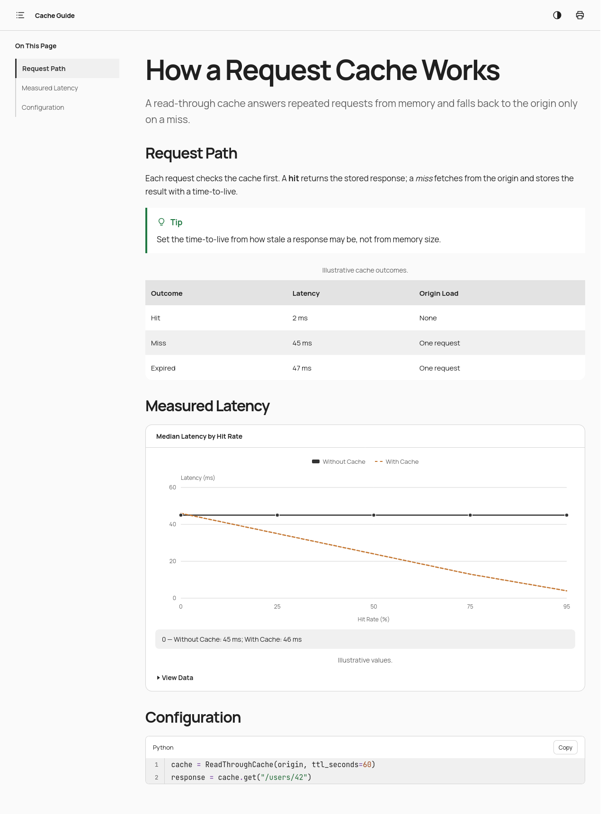
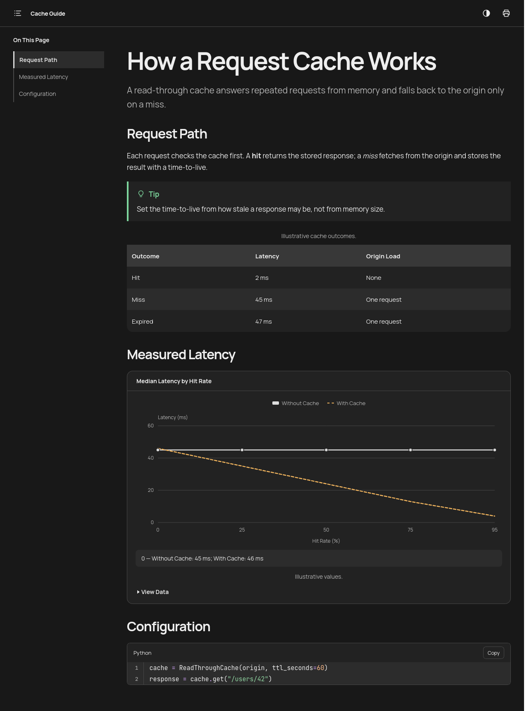
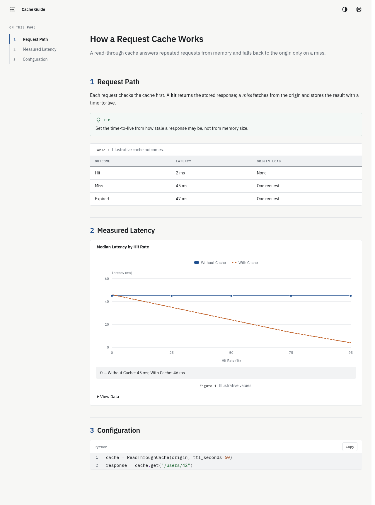
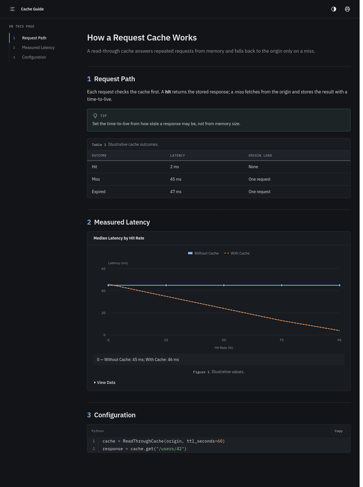
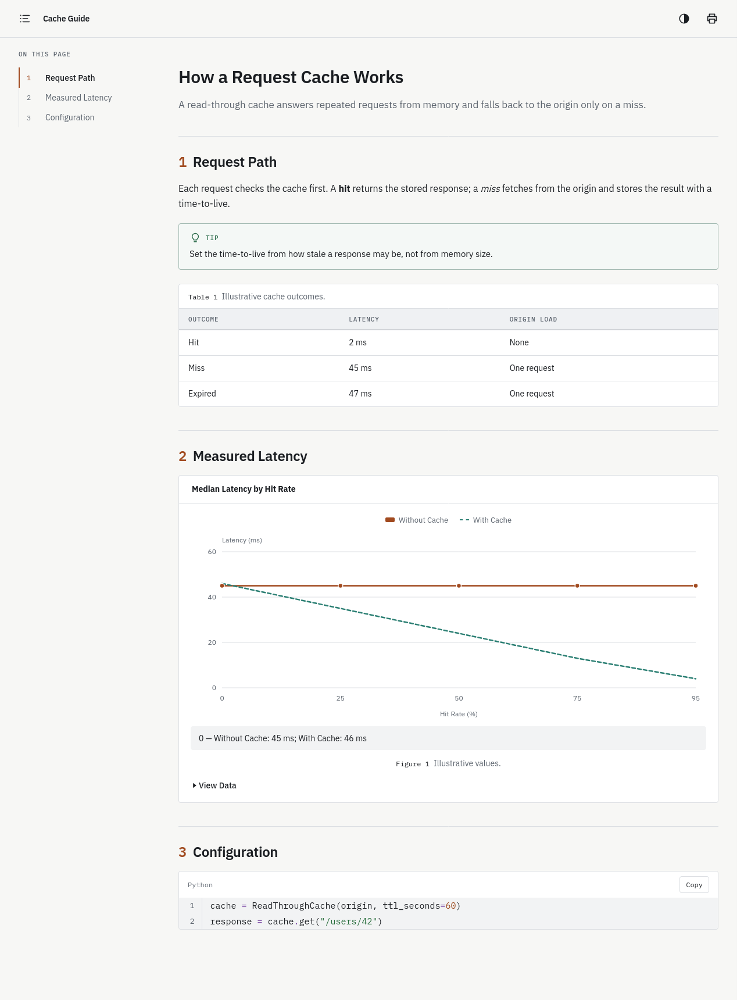
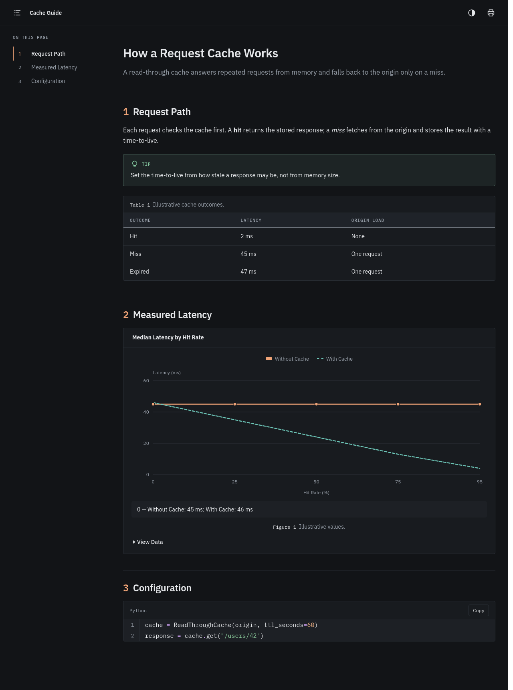

# Visual Explainer Themes

The [visual-explainers](../../skills/documentation/visual-explainers/SKILL.md) skill builds each document with one theme set and one accent color. The agent asks which you want before building; answer **Choose For Me**, or don't answer, and it picks the combination that suits the content. You can also name a theme in your request, for example "use the report theme with the blue accent."

The theme is fixed when the document is built. Readers can switch only between System, Light, and Dark appearances from the header menu, so every theme below includes both.

| Theme | Accents | Best For |
| --- | --- | --- |
| `plain` (default) | `graphite` (default) | General explainers, guides, and walkthroughs |
| `report` | `blue` (default), `rust` | Formal reports and analyses that refer to numbered sections, tables, and figures |

Both themes also accept a custom accent as a light and dark color pair, such as "a green accent of `#2f6f3e` in light mode and `#8fd19e` in dark mode." The builder rejects a pair that doesn't keep 4.5:1 contrast with the page, panels, and button text in both appearances.

## Plain

A clean, unnumbered layout using Manrope and JetBrains Mono, with a gray `graphite` accent.

| Light | Dark |
| --- | --- |
|  |  |

## Report

A restrained report style using IBM Plex Sans and IBM Plex Mono. It numbers sections, subsections, and their contents entries, and labels captioned tables and figures, such as "Table 1" and "Figure 1."

### Blue Accent

| Light | Dark |
| --- | --- |
|  |  |

### Rust Accent

| Light | Dark |
| --- | --- |
|  |  |
